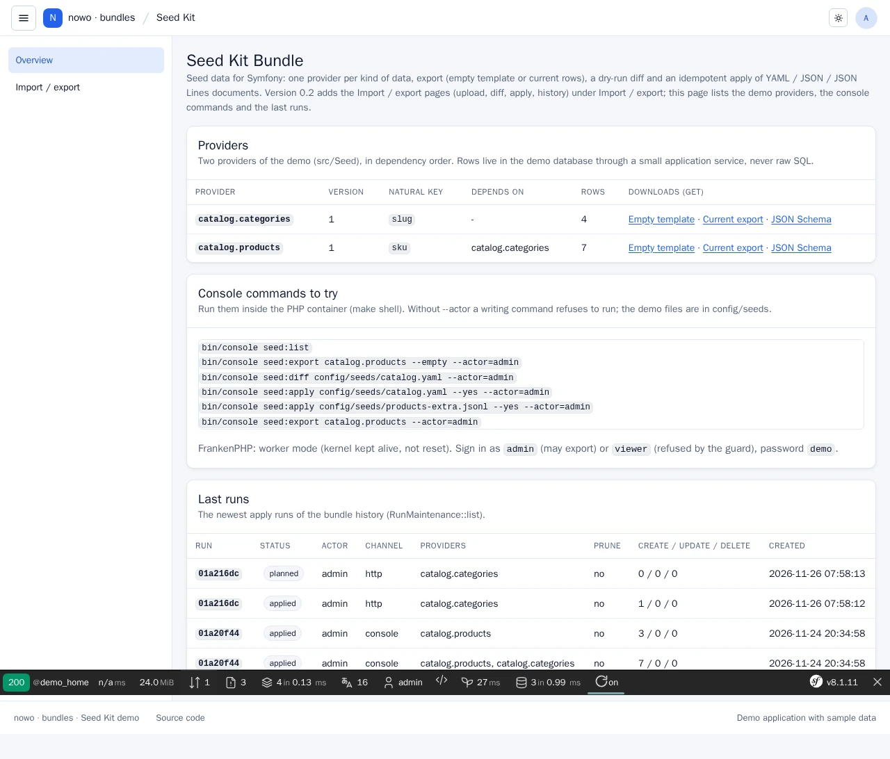
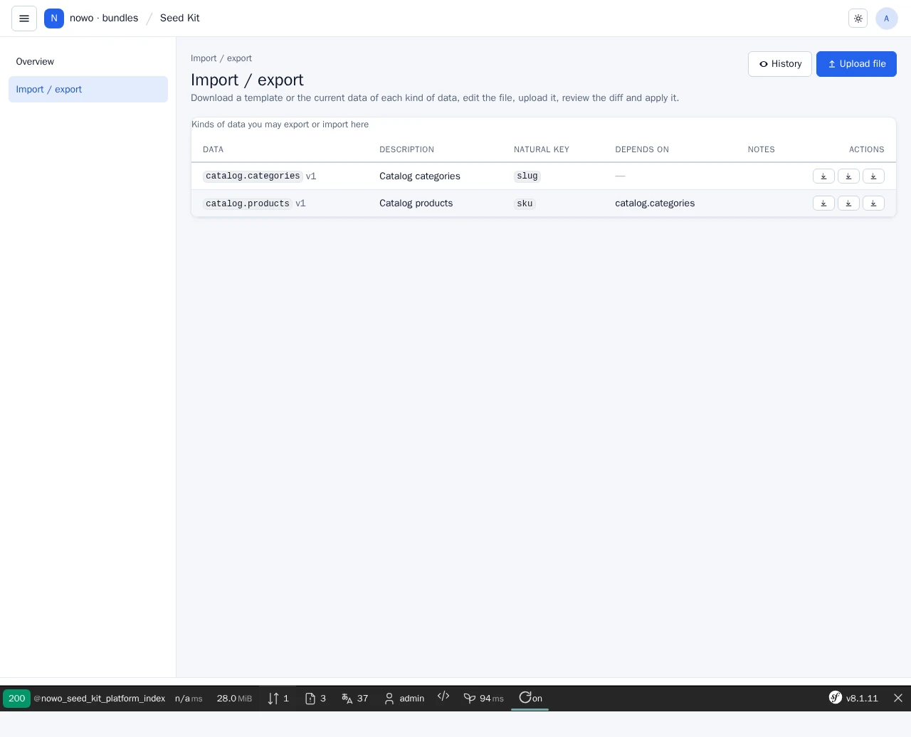
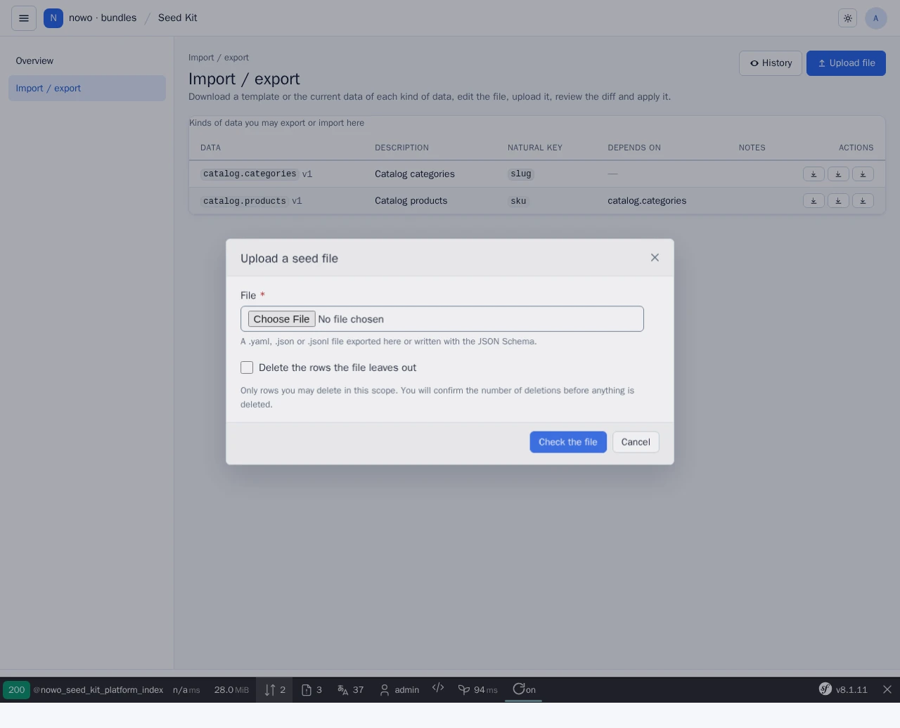
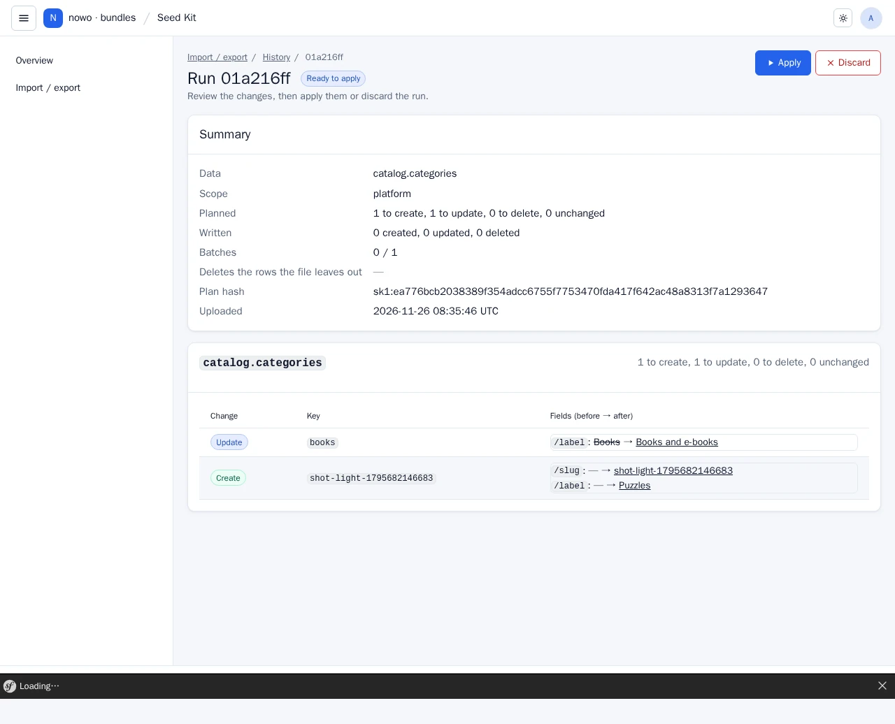
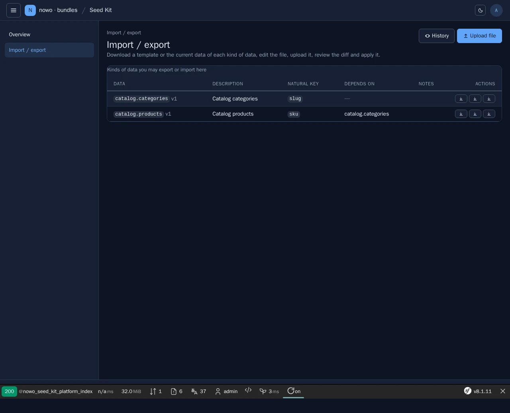
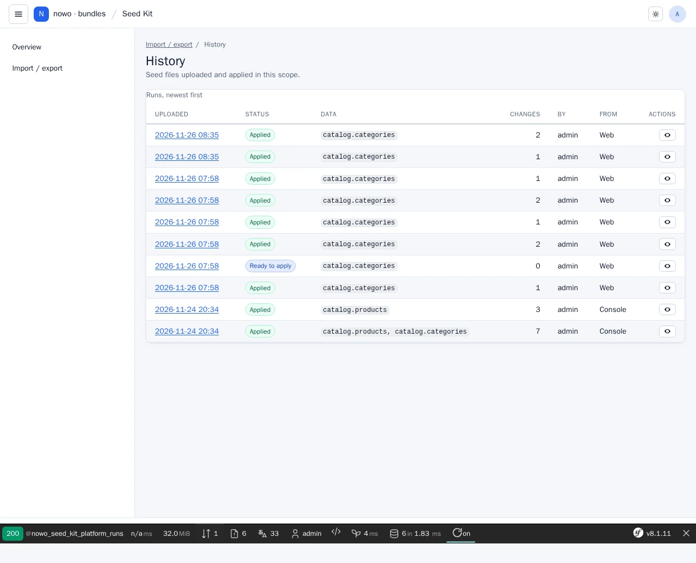
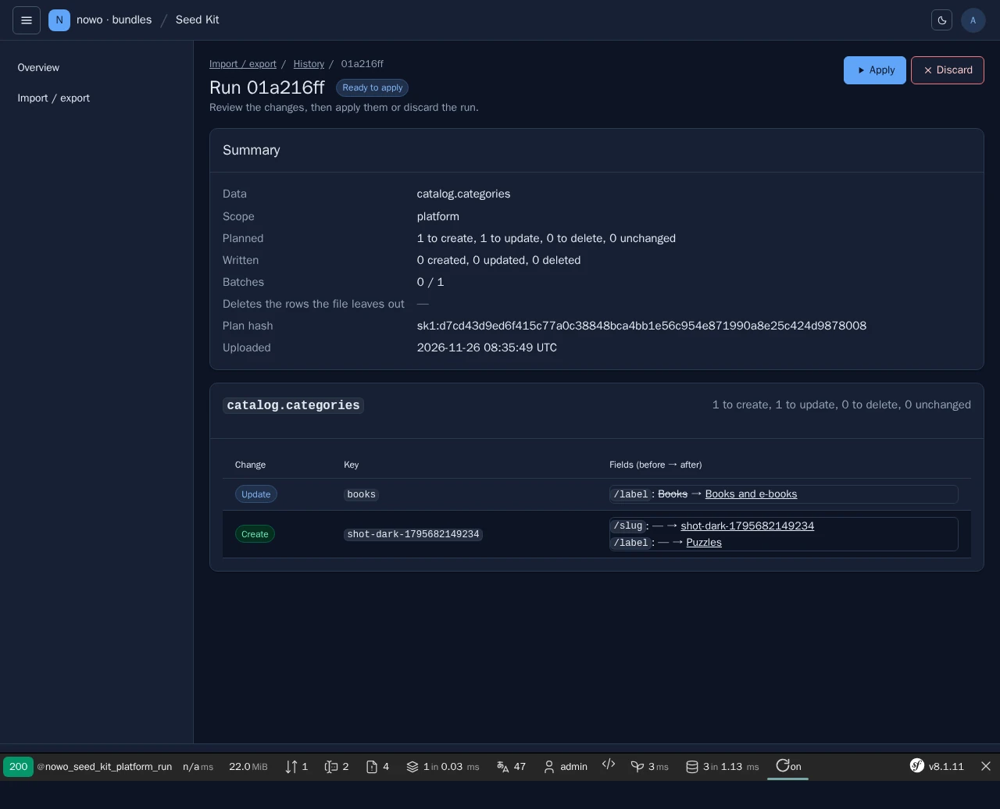

# Seed Kit Bundle

[](https://github.com/nowo-tech/SeedKitBundle/actions/workflows/ci.yml) [](https://packagist.org/packages/nowo-tech/seed-kit-bundle) [](https://packagist.org/packages/nowo-tech/seed-kit-bundle) [](LICENSE) [](https://php.net) [](https://symfony.com) [](https://github.com/nowo-tech/SeedKitBundle) [](#tests-and-coverage)

> ⭐ **Found this useful?** Install it from [Packagist](https://packagist.org/packages/nowo-tech/seed-kit-bundle) and give it a star on [GitHub](https://github.com/nowo-tech/SeedKitBundle): it helps us maintain and improve the project.

**Seed data for Symfony, one provider per kind of data.** Export an empty commented template or the current rows of
a provider as YAML, JSON or JSON Lines; edit the file by hand or with an AI that reads the published JSON Schema;
dry-run it as a diff with a plan hash; apply it in idempotent batches through your application's own handlers, under
a lease, with access checks and an audit entry. Applying the same file twice changes nothing.

**Standard Symfony by default, DDD / hexagonal opt-in:** a standard host extends `AbstractSeedProvider` and calls its
services; a DDD host implements `SeedProviderInterface` in its infrastructure layer and calls its command handlers.
The public API is interfaces and value objects with no Symfony, Doctrine or HTTP types; the bundle's two tables are
mapped read-only and written through DBAL, so the bundle never flushes, clears or resets an entity manager.

> 📋 **Compatible with Symfony 7.4, 8.0 and 8.1** · PHP 8.2+ (Symfony 8.x requires PHP 8.4+)


This bundle is **FrankenPHP worker mode friendly**.



## Features

- **Providers**: one tagged service per kind of data (`#[AsSeedProvider(name: 'crm.contacts')]` or the tag
  `nowo_seed_kit.provider`), keyed by **natural keys** (never database ids), with dependencies applied in order
  (companies before contacts; unknown dependencies and cycles fail the container build).
- **Documents**: YAML (default, multi-document with `---`), JSON (one object or `{"documents": [...]}`) and JSON Lines
  (streamed, for large files); an empty template with field comments and examples, or the current rows, round-trip
  stable ([FORMAT.md](docs/FORMAT.md)).
- **JSON Schema** per provider (draft 2020-12, local `$ref` only, `x-seed-*` keywords for keys, secrets, personal data,
  references and read-only fields), published for editors and AI tools, linted on `cache:warmup` and by a command.
- **Dry run**: the plan per row (create / update / unchanged / delete, changed fields) and a **plan hash** (`sk1:…`,
  [PLAN-HASH.md](docs/PLAN-HASH.md)); every check that can fail runs before the first write.
- **Apply**: re-plans and refuses a stale plan; batches of `apply.batch_size` rows, one transaction each, under a lease
  per (provider, scope); each batch is re-planned with the provider's write lock and must match its reviewed digest;
  progress is committed with the batch; re-applying a partially applied file converges
  ([CONCURRENCY.md](docs/CONCURRENCY.md)).
- **Prune** (delete the rows the file omits) is opt-in per call, needs its own permission (`SEED_PRUNE`, nobody by
  default) and is guarded against mass and empty prunes.
- **Secrets never leave in clear**: secret fields export as `vault:<ref>` of the scope or are omitted; imports accept
  only references that a validator port (optional VaultBundle bridge) confirms; plaintext is refused without being
  echoed.
- **Hardened reader**: size, item, depth, string, property, line and node caps; YAML without tags, anchors, aliases,
  merge keys or directives; duplicate keys refused; console paths confined to allowed directories.
- **Access**: `SEED_EXPORT` / `SEED_APPLY` / `SEED_PRUNE` voter, role-based checker (`security.*`), an
  `access_checker` port and the `nowo_seed_kit.access_check` event; scopes (`platform`, `organization`, `project` or
  any host kind) resolved by a host port; deny by default.
- **Audit**: every apply and prune that passed the access check (every outcome) and every current export of a
  provider with personal-data or secret fields, through a PSR-3 sink or the AuditKit bridge; values are never logged.
- **Console**: `nowo:seed-kit:{list,schema,export,diff,apply,runs:list,runs:purge,actor:forget,lint}` with `seed:*`
  aliases; `--actor=system` for fresh installs (console only).
- **Contract test kit**: `Nowo\SeedKitBundle\Testing\SeedProviderContractTestCase` runs the round-trip, idempotency,
  stable-export, no-secret, no-escalation and row-visibility checks on your providers.
- FrankenPHP worker mode, kernel kept alive and **not reset** (kernel reset false): services hold configuration only,
  the one memo is bounded and resettable, and a 1 000-request worker test runs in CI
  ([FRANKENPHP-WORKER-AUDIT.md](docs/FRANKENPHP-WORKER-AUDIT.md)).
- 10 locales (en, es, it, fr, pt, de, nl, ca, eu, gl), translation domain `NowoSeedKitBundle`.

- **Import / export pages** (0.2, opt-in): one page per scope kind at a prefix you choose, on UiKit scaffolds and
  FormKit forms, wrapped in your layout (`ui.layout`): downloads, an upload dialog loaded when it opens, the diff,
  apply / discard, history and progress ([TEMPLATES.md](docs/TEMPLATES.md)).
- **Asynchronous apply** (0.2, opt-in): large UI applies are queued as `ApplySeedRun` on your Messenger transport and
  applied once, as the run's actor, even on redelivery; a Scheduler bridge expires stored documents and purges the
  history.

| Import / export | Upload dialog | Diff before apply |
| --- | --- | --- |
|  |  |  |
|  |  |  |

## Installation

```bash
composer require nowo-tech/seed-kit-bundle
```

With Symfony Flex the recipe registers the bundle and writes `config/packages/nowo_seed_kit.yaml`. Create the two
bundle tables with your migrations or the Doctrine schema tool ([docs/INSTALLATION.md](docs/INSTALLATION.md)), write a
provider, then:

```bash
bin/console nowo:seed-kit:list
bin/console nowo:seed-kit:export catalog.categories --empty --actor=admin --output=config/seeds/categories.yaml
bin/console nowo:seed-kit:diff config/seeds/categories.yaml --actor=admin
bin/console nowo:seed-kit:apply config/seeds/categories.yaml --yes --actor=admin
```

## Requirements

- PHP >= 8.2, < 8.6 with `ext-json` and `ext-mbstring` (`ext-intl` for the `nfc` key normaliser)
- Symfony 7.4, 8.0 or 8.1; Doctrine DBAL 3.8+ / 4, ORM 3.7+, DoctrineBundle 2.8+ / 3
- `opis/json-schema` ^2.6, `nowo-tech/transaction-contract` ^1.1, `nowo-tech/transaction-doctrine` ^1.10.1
- MySQL 8.4, MariaDB 11.4, PostgreSQL 16+ or SQLite
- Optional: `symfony/security-bundle` (voter, role checker, user actor), `symfony/translation` (translated console
  messages), `phpunit/phpunit` (contract test kit), `nowo-tech/audit-kit-bundle` (audit bridge),
  `nowo-tech/vault-bundle` (secret-reference bridge)

## Configuration

Zero configuration works for a standard host with one `platform` scope. A multi-tenant host declares its scope kinds,
a scope resolver and its access mapping:

```yaml
nowo_seed_kit:
    scope_kinds:
        platform:     { requires_id: false }
        organization: { requires_id: true }
    scope_resolver: App\Seed\TenantScopeResolver
    security:
        prune_roles: [ROLE_ADMIN]
        providers:
            crm.contacts: { export_roles: [ROLE_CRM_ADMIN], apply_roles: [ROLE_CRM_ADMIN] }
```

Every key, its default and its range: [docs/CONFIGURATION.md](docs/CONFIGURATION.md).

## Usage

**[Standard Symfony host](docs/USAGE.md#standard-symfony-host)**: extend `AbstractSeedProvider`, describe one item with a JSON Schema, read the current rows
by natural key and write through your own services:

```php
#[AsSeedProvider(name: 'catalog.categories')]
final class CategoryProvider extends AbstractSeedProvider
{
    public function name(): ProviderName { return new ProviderName('catalog.categories'); }
    public function version(): int { return 1; }
    public function scopes(): array { return [new ScopeKind(ScopeKind::PLATFORM)]; }
    public function schema(): SeedSchema { /* item schema with 'x-seed-key' => ['slug'] */ }
    public function exportCurrent(SeedContext $context): iterable { /* one SeedItem per row, by slug */ }
    public function applyBatch(SeedContext $context, AppliedBatch $batch): BatchResult { /* your services */ }
    protected function currentRows(SeedContext $context, array $keys, PlanOptions $options): array { /* by key */ }
}
```

**[DDD / hexagonal host](docs/USAGE.md#ddd--hexagonal-host)**: implement `SeedProviderInterface` in the infrastructure layer, plan with your read model,
apply through your command handlers, and plug your own scope resolver, actor resolver and access checker.

Both paths in full, the schema keywords, secrets, prune, every console command with its exit codes, the AI editing
workflow, the access mapping and the contract test kit: [docs/USAGE.md](docs/USAGE.md).

## Demo

`demo/symfony8` (Symfony 8.1, PHP 8.5, http://localhost:8271): FrankenPHP worker mode, MySQL 8.4, UiKit layout, two
providers (`catalog.categories` and `catalog.products`, with a reference and a float price), seed files in
`config/seeds`, a home page with row counts and the last runs, and downloads of the template, the current export and
the schema for `admin` (may export) and `viewer` (denied), password `demo`. `make -C demo up-symfony8`, then
`make -C demo/symfony8 seed`, `make test-e2e` and `make demo-screenshots`. See
[docs/DEMO-FRANKENPHP.md](docs/DEMO-FRANKENPHP.md).

## Documentation

- [Installation](docs/INSTALLATION.md)
- [Configuration](docs/CONFIGURATION.md)
- [Usage](docs/USAGE.md)
- [Contributing](docs/CONTRIBUTING.md)
- [Code of Conduct](CODE_OF_CONDUCT.md)
- [Changelog](docs/CHANGELOG.md)
- [Upgrading](docs/UPGRADING.md)
- [Release](docs/RELEASE.md)
- [Security](docs/SECURITY.md)
- [Engram](docs/ENGRAM.md)
- [Spec-driven development](docs/SPEC-DRIVEN-DEVELOPMENT.md)
- [GitHub Spec Kit](docs/SPEC-KIT.md)
- [Roadmap](docs/ROADMAP.md)

### Additional documentation

- [Document format](docs/FORMAT.md)
- [Plan hash and batch digests](docs/PLAN-HASH.md)
- [Architecture](docs/ARCHITECTURE.md)
- [Concurrency](docs/CONCURRENCY.md)
- [FrankenPHP worker audit](docs/FRANKENPHP-WORKER-AUDIT.md)
- [Privacy](docs/PRIVACY.md)
- [Templates and pages](docs/TEMPLATES.md)
- [Contract](docs/CONTRACT.md)
- [Demo with FrankenPHP](docs/DEMO-FRANKENPHP.md)
- [GitHub Actions CI](docs/GITHUB_CI.md)
- [PSR evaluation](docs/PSR.md)

## Tests and coverage

- Unit, integration and database suites (PHPUnit): value objects and canonical JSON, the hostile reader corpus, the
  planner, applier and exporter, the contract test kit, the console commands, the access matrix, the container wiring
  of a standard and a DDD host, and a worker test (one kernel, 1 000 mixed requests, two actors, flat memory). The
  database suite runs on SQLite and, in CI, on MySQL 8.4, MariaDB 11.4 and PostgreSQL, including the two-connection
  lease and lock tests.
- Coverage:
  - PHP: 100%
  - TS/JS: N/A
  - Python: N/A

## License

MIT. See [LICENSE](LICENSE).

## Author

Created by [Héctor Franco Aceituno](https://github.com/HecFranco) at [Nowo.tech](https://nowo.tech).
